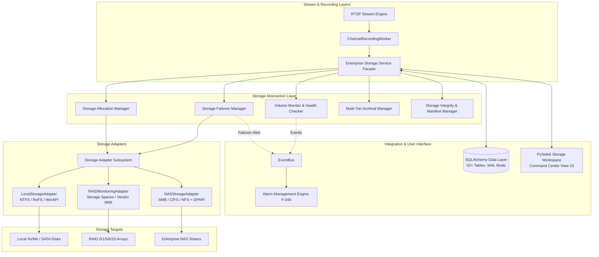
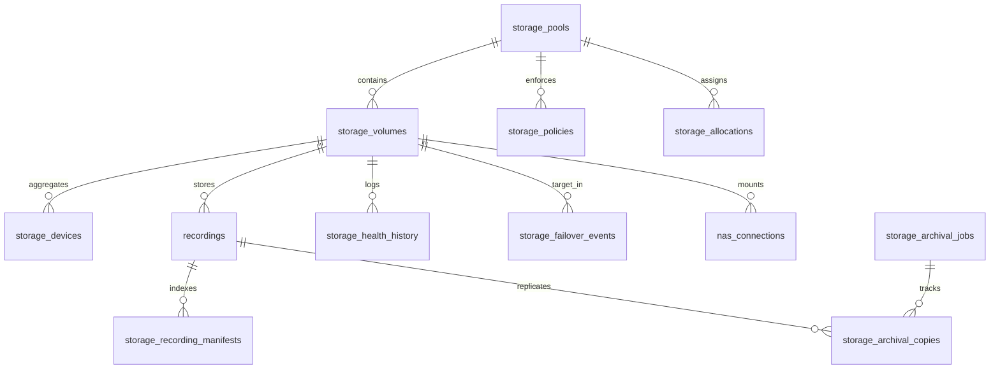
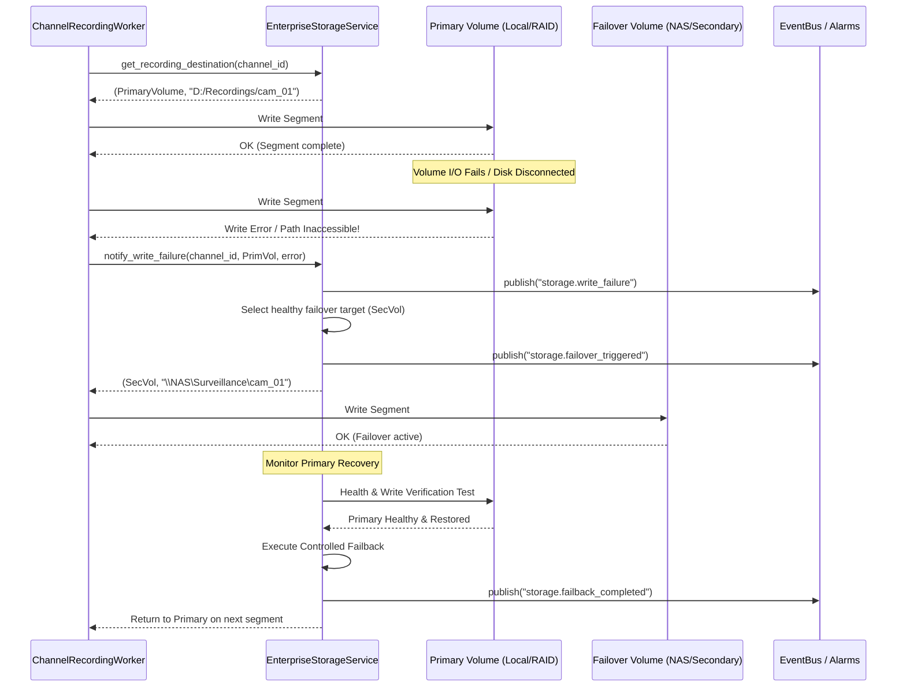

# CCTV AI INTELLIGENCE PLATFORM
# PHASE 13 — ENTERPRISE STORAGE MANAGEMENT, RAID MONITORING, NAS INTEGRATION & AUTOMATED FAILOVER
## SYSTEM ARCHITECTURE & TECHNICAL DESIGN SPECIFICATION

---

### METADATA & REVISION CONTROL
- **Document Version**: `1.0.0`
- **Release Target**: `1.3.0-alpha`
- **Feature ID**: `F-047` (Enterprise Storage Management, RAID Monitoring & NAS Integration)
- **Change ID**: `CHG-20261125-012`
- **Baseline Git Commit**: `2bec6f2e052fc1873eaea549deb4c4978e494e6d`
- **Target Git Branch**: `master`
- **Author**: Antigravity Platform Architecture Agent
- **Date**: `2026-11-25`
- **Status**: **APPROVED & AUTHORIZED FOR IMPLEMENTATION**

---

## 1. EXECUTIVE SUMMARY & ARCHITECTURAL OBJECTIVES

Phase 13 establishes an enterprise-grade, hardware-independent storage management subsystem for the CCTV AI Intelligence Platform. In enterprise video surveillance deployments, storage is the most data-intensive and mission-critical component: high-definition cameras generate continuous, non-stop streams that must be recorded with zero silent data loss, indexed, verified, tiered, and retained in compliance with evidentiary and statutory retention standards.

The overarching design objective is to introduce a **hardware-independent Storage Abstraction Layer** between the existing recording engine and the physical/network storage devices:
1. **Hardware Independence**: Support local direct-attached storage (SATA, NVMe, USB), hardware RAID arrays (RAID 0/1/5/6/10), Windows Storage Spaces, and Network-Attached Storage (SMB/CIFS shares and NFS mounts) through uniform adapter interfaces.
2. **Zero-Gap Recording Continuity**: Detect primary storage write failures, volume dismounts, or network share disconnections within seconds and dynamically redirect camera recording segments to designated secondary or failover volumes, maintaining comprehensive recording manifests and explicitly calculating and logging any recording gaps.
3. **Multi-Tier Archival**: Implement policy-driven migration across **Hot** (local fast NVMe/SSD buffer), **Warm** (bulk SATA / RAID surveillance tier), and **Cold/Archive** (NAS / optical / cloud-tier storage) with strict cryptographic SHA-256 copy verification prior to source pruning.
4. **Evidentiary Hold & Lock Preservation**: Guarantee that recordings flagged as `is_locked=True` or linked to forensic evidence packages (`F-018`, `F-023`) are **strictly excluded** from automatic retention pruning and cannot be deleted or relocated in a way that invalidates forensic references.
5. **Non-Disruptive Modular Monolith Extension**: Implement the subsystem under `engines/storage_engine/` without requiring external microservices, preserving all existing recording, playback, and forensic API signatures while extending the relational database schema.
6. **Alarm Management Integration**: Fully integrate with the Phase 12 Unified Alarm Management Engine (`F-046`), generating categorized, prioritized, and deduplicated alarms for volume thresholds, disk failures, RAID degradation, and failover events.
7. **Windows 11 Enterprise Platform Native**: Leverage Windows API capabilities including volume GUID paths, NTFS/ReFS capability detection, Windows Storage Spaces WMI providers, and DPAPI-encrypted NAS credentials.

---

## 2. HIGH-LEVEL ARCHITECTURE & SUBSYSTEM DECOMPOSITION



### Subsystem Components:
1. **`EnterpriseStorageService` (`engines/storage_engine/storage_service.py`)**: Central orchestrator and singleton facade coordinating adapters, allocation, failover, monitoring, archival, and EventBus messaging.
2. **`StorageAdapter` Base Hierarchy (`engines/storage_engine/adapters/`)**:
   - `StorageAdapter` (Abstract Base Class): Uniform interface for path resolution, write testing, metric sampling, free-space querying, and availability checking.
   - `LocalStorageAdapter`: Windows volume enumeration, drive letters and mount points, NTFS and ReFS capability detection, disk-free space via Windows API (`ctypes.windll.kernel32.GetDiskFreeSpaceExW`).
   - `RAIDMonitoringAdapter`: Hardware-independent interpretation of RAID configurations (RAID 0, 1, 5, 6, 10). Probes Windows Storage Spaces (`MSFT_StoragePool`, `MSFT_VirtualDisk`, `MSFT_PhysicalDisk`) and vendor controller interfaces, clearly distinguishing *directly measured*, *vendor API*, *estimated*, and *unsupported*.
   - `NASStorageAdapter`: Probing and lifecycle management of SMB/CIFS and NFS shares. Secures credentials using the platform's DPAPI master key vault, measures network round-trip latency and write throughput, detects disconnections, and executes bounded exponential backoff reconnection.
3. **`VolumeMonitor` (`engines/storage_engine/volume_monitor.py`)**: Background poller tracking volume health, utilization percentages, free-space safety margins, and SMART status trends. Emits structured warnings and critical alerts before capacity exhaustion occurs.
4. **`StoragePolicyEngine` (`engines/storage_engine/policy_engine.py`)**: Manages allocation rules, per-camera recording quotas, retention policies, minimum free-space safety reserves, and tier migration rules.
5. **`StorageAllocationManager` (`engines/storage_engine/allocation_manager.py`)**: Resolves the optimal physical and logical recording destination for each camera channel based on site, recording profile, priority, and volume health.
6. **`StorageFailoverManager` (`engines/storage_engine/failover_manager.py`)**: Detects write errors, timeouts, or volume unreachability during recording. Selects healthy alternate failover targets, coordinates seamless segment handoff, logs recording gaps, monitors primary storage recovery, and executes controlled failback.
7. **`StorageIntegrityManager` (`engines/storage_engine/integrity_manager.py`)**: Generates and verifies cryptographic recording manifests (`RecordingManifest`), cross-checks segment SHA-256 hashes, detects missing frames or dropped files, and audits database-to-disk consistency.
8. **`StorageArchivalManager` (`engines/storage_engine/archival_manager.py`)**: Coordinates scheduled background migration from Hot to Warm and Warm to Cold tiers. Computes destination checksums, verifies exact matching against source manifests, and updates recording references before safely pruning source files.
9. **`StorageScheduler` (`engines/storage_engine/scheduler.py`)**: Threaded maintenance worker running health checks, retention pruning, capacity forecasting, and archival jobs outside the PySide6 UI thread.
10. **`StorageManagementWidget` (`modules/storage_management/storage_workspace_widget.py`)**: Comprehensive 8-tab PySide6 surveillance storage administration workspace mounted as View 10 in the main Command Center.

---

## 3. RELATIONAL DATABASE SCHEMA DESIGN

Phase 13 extends the existing SQLAlchemy data models without destroying or altering existing tables. Existing `storage_volumes` and `storage_events` tables are preserved and extended, and new tables are introduced under `database/models/storage.py`.



### Table Definitions:

#### 1. `storage_pools`
Logical groupings of storage volumes into operational tiers.
- `id` (VARCHAR(36), PK, UUID)
- `name` (VARCHAR(100), NOT NULL, UNIQUE)
- `pool_tier` (VARCHAR(20), NOT NULL) — `HOT`, `WARM`, `COLD`, `ARCHIVE`
- `description` (TEXT)
- `min_free_space_gb` (FLOAT, DEFAULT 20.0)
- `is_active` (BOOLEAN, DEFAULT TRUE)
- `created_at`, `updated_at`, `is_deleted`

#### 2. `storage_volumes` (Extending Existing Model)
Extends the existing Phase 4 `storage_volumes` table via automatic schema migration:
- `pool_id` (VARCHAR(36), FK `storage_pools.id`, NULLABLE)
- `volume_type` (VARCHAR(20), DEFAULT 'LOCAL') — `LOCAL`, `RAID`, `NAS_SMB`, `NAS_NFS`
- `filesystem` (VARCHAR(20), DEFAULT 'NTFS') — `NTFS`, `ReFS`, `FAT32`, `SMB`, `NFS`
- `volume_status` (VARCHAR(20), DEFAULT 'ONLINE') — `ONLINE`, `DEGRADED`, `OFFLINE`, `READ_ONLY`, `FULL`
- `is_failover_target` (BOOLEAN, DEFAULT FALSE)
- `reserved_bytes` (BIGINT, DEFAULT 0)
- `health_score` (FLOAT, DEFAULT 100.0)
- `mount_options` (TEXT, NULLABLE)

#### 3. `storage_devices`
Represents physical disk drives backing local volumes or RAID arrays.
- `id` (VARCHAR(36), PK, UUID)
- `volume_id` (VARCHAR(36), FK `storage_volumes.id`, NULLABLE)
- `device_path` (VARCHAR(255), NOT NULL) — e.g., `\\.\PhysicalDrive0`
- `model` (VARCHAR(100))
- `serial_number` (VARCHAR(100), INDEX)
- `bus_type` (VARCHAR(20)) — `NVMe`, `SATA`, `SAS`, `USB`, `SCSI`
- `size_bytes` (BIGINT, NOT NULL)
- `smart_status` (VARCHAR(20), DEFAULT 'HEALTHY') — `HEALTHY`, `WARNING`, `FAILING`, `UNKNOWN`
- `temperature_c` (FLOAT, NULLABLE)
- `power_on_hours` (INTEGER, NULLABLE)
- `health_score` (FLOAT, DEFAULT 100.0)
- `is_healthy` (BOOLEAN, DEFAULT TRUE)

#### 4. `storage_policies`
Storage quota, retention, and threshold rules.
- `id` (VARCHAR(36), PK, UUID)
- `name` (VARCHAR(100), NOT NULL)
- `pool_id` (VARCHAR(36), FK `storage_pools.id`, NULLABLE)
- `warning_threshold_pct` (FLOAT, DEFAULT 85.0)
- `critical_threshold_pct` (FLOAT, DEFAULT 95.0)
- `min_free_gb` (FLOAT, DEFAULT 10.0)
- `retention_days` (INTEGER, DEFAULT 30)
- `failover_enabled` (BOOLEAN, DEFAULT TRUE)
- `failover_pool_id` (VARCHAR(36), NULLABLE)
- `archival_enabled` (BOOLEAN, DEFAULT FALSE)
- `archival_age_days` (INTEGER, DEFAULT 14)

#### 5. `storage_allocations`
Maps cameras and recording profiles to storage pools and volumes.
- `id` (VARCHAR(36), PK, UUID)
- `channel_id` (VARCHAR(64), NOT NULL, INDEX)
- `pool_id` (VARCHAR(36), FK `storage_pools.id`, NOT NULL)
- `primary_volume_id` (VARCHAR(36), FK `storage_volumes.id`, NOT NULL)
- `failover_volume_id` (VARCHAR(36), FK `storage_volumes.id`, NULLABLE)
- `quota_bytes` (BIGINT, DEFAULT 0) — 0 = unlimited
- `priority` (VARCHAR(20), DEFAULT 'NORMAL') — `CRITICAL`, `HIGH`, `NORMAL`, `LOW`

#### 6. `storage_health_history`
Time-series log of volume and disk operational metrics.
- `id` (VARCHAR(36), PK, UUID)
- `volume_id` (VARCHAR(36), FK `storage_volumes.id`, NOT NULL, INDEX)
- `measured_at` (DATETIME(timezone=True), NOT NULL, INDEX)
- `read_latency_ms` (FLOAT, DEFAULT 0.0)
- `write_latency_ms` (FLOAT, DEFAULT 0.0)
- `throughput_mbps` (FLOAT, DEFAULT 0.0)
- `used_pct` (FLOAT, NOT NULL)
- `free_gb` (FLOAT, NOT NULL)
- `status` (VARCHAR(20), DEFAULT 'HEALTHY')
- `error_details` (TEXT, NULLABLE)

#### 7. `storage_failover_events`
Audit record of storage failover incidents and recovery.
- `id` (VARCHAR(36), PK, UUID)
- `channel_id` (VARCHAR(64), NOT NULL, INDEX)
- `primary_volume_id` (VARCHAR(36), FK `storage_volumes.id`, NOT NULL)
- `failover_volume_id` (VARCHAR(36), FK `storage_volumes.id`, NOT NULL)
- `triggered_at` (DATETIME(timezone=True), NOT NULL, INDEX)
- `resolved_at` (DATETIME(timezone=True), NULLABLE)
- `failback_at` (DATETIME(timezone=True), NULLABLE)
- `reason` (VARCHAR(255), NOT NULL)
- `status` (VARCHAR(20), DEFAULT 'ACTIVE') — `ACTIVE`, `RECOVERED`, `FAILED_BACK`
- `gap_seconds` (FLOAT, DEFAULT 0.0)
- `segments_redirected` (INTEGER, DEFAULT 0)

#### 8. `storage_recording_manifests`
Individual segment tracking manifests guaranteeing end-to-end provenance.
- `id` (VARCHAR(36), PK, UUID)
- `recording_id` (VARCHAR(36), INDEX)
- `segment_id` (VARCHAR(36), INDEX)
- `channel_id` (VARCHAR(64), NOT NULL, INDEX)
- `stream_id` (VARCHAR(20), DEFAULT 'MAIN')
- `start_time` (DATETIME(timezone=True), NOT NULL, INDEX)
- `end_time` (DATETIME(timezone=True), NULLABLE)
- `destination_volume_id` (VARCHAR(36), NOT NULL)
- `file_path` (VARCHAR(500), NOT NULL)
- `sha256_hash` (VARCHAR(64), NULLABLE)
- `file_size_bytes` (BIGINT, DEFAULT 0)
- `duration_sec` (INTEGER, DEFAULT 0)
- `is_failover` (BOOLEAN, DEFAULT FALSE)
- `failover_event_id` (VARCHAR(36), NULLABLE)
- `verification_status` (VARCHAR(20), DEFAULT 'VERIFIED')

#### 9. `storage_archival_jobs`
Lifecycle archival batch execution records.
- `id` (VARCHAR(36), PK, UUID)
- `source_volume_id` (VARCHAR(36), NOT NULL)
- `target_volume_id` (VARCHAR(36), NOT NULL)
- `target_tier` (VARCHAR(20), NOT NULL) — `WARM`, `COLD`
- `status` (VARCHAR(20), DEFAULT 'QUEUED') — `QUEUED`, `IN_PROGRESS`, `COMPLETED`, `FAILED`
- `started_at` (DATETIME(timezone=True), NOT NULL)
- `completed_at` (DATETIME(timezone=True), NULLABLE)
- `total_files` (INTEGER, DEFAULT 0)
- `files_transferred` (INTEGER, DEFAULT 0)
- `bytes_transferred` (BIGINT, DEFAULT 0)
- `verification_failed_count` (INTEGER, DEFAULT 0)
- `error_message` (TEXT, NULLABLE)

#### 10. `storage_archival_copies`
Tracks verified copies of recording segments in secondary/cold tiers.
- `id` (VARCHAR(36), PK, UUID)
- `recording_id` (VARCHAR(36), NOT NULL, INDEX)
- `segment_id` (VARCHAR(36), NULLABLE)
- `job_id` (VARCHAR(36), FK `storage_archival_jobs.id`, NULLABLE)
- `target_volume_id` (VARCHAR(36), NOT NULL)
- `archive_path` (VARCHAR(500), NOT NULL)
- `tier` (VARCHAR(20), NOT NULL)
- `sha256_hash` (VARCHAR(64), NOT NULL)
- `verified_at` (DATETIME(timezone=True), NOT NULL)
- `status` (VARCHAR(20), DEFAULT 'VERIFIED')

#### 11. `nas_connections`
Secure profile for Network-Attached Storage connections.
- `id` (VARCHAR(36), PK, UUID)
- `name` (VARCHAR(100), NOT NULL, UNIQUE)
- `protocol` (VARCHAR(10), DEFAULT 'SMB') — `SMB`, `NFS`
- `host` (VARCHAR(255), NOT NULL)
- `share_name` (VARCHAR(255), NOT NULL)
- `mount_point` (VARCHAR(255), NOT NULL)
- `username` (VARCHAR(100), NULLABLE)
- `encrypted_password_envelope` (TEXT, NULLABLE) — DPAPI AES-256-GCM envelope
- `status` (VARCHAR(20), DEFAULT 'DISCONNECTED') — `CONNECTED`, `DISCONNECTED`, `AUTH_FAILED`, `DEGRADED`
- `last_latency_ms` (FLOAT, DEFAULT 0.0)
- `last_connected_at` (DATETIME(timezone=True), NULLABLE)
- `error_message` (TEXT, NULLABLE)

---

## 4. ADAPTER SUBSYSTEM SPECIFICATIONS

### 4.1 LocalStorageAdapter
Responsible for querying and managing Windows direct-attached storage:
- **Drive & Mount Point Discovery**: Enumerate logical drives via `win32api` / `ctypes.windll.kernel32.GetLogicalDriveStringsW`.
- **Filesystem Capabilities**: Call `GetVolumeInformationW` to retrieve volume label, serial number, max component length, filesystem flags, and filesystem type name (`NTFS`, `ReFS`). Check flags for `FILE_READ_ONLY_VOLUME`, `FILE_SUPPORTS_ENCRYPTION`, `FILE_VOLUME_IS_COMPRESSED`.
- **Capacity & Free Space**: Call `GetDiskFreeSpaceExW` to retrieve `lpFreeBytesAvailableToCaller`, `lpTotalNumberOfBytes`, and `lpTotalNumberOfFreeBytes`.
- **Write Validation**: Atomically create, write 4 KB buffer, verify, and delete a transient test marker (`.storage_write_test_{uuid}`) with sync flush to confirm read/write health.

### 4.2 RAIDMonitoringAdapter
Hardware-independent RAID monitoring adapter providing consistent telemetry across controller types:
- **Supported RAID Levels**:
  - `RAID 0` (Striping — zero redundancy, maximum speed)
  - `RAID 1` (Mirroring — 1 disk fault tolerance)
  - `RAID 5` (Distributed Parity — 1 disk fault tolerance)
  - `RAID 6` (Dual Parity — 2 disk fault tolerance)
  - `RAID 10` (Striped Mirrors — 1+ disk fault tolerance)
- **Windows Storage Spaces Integration**: Query Windows WMI / CIM namespace `root\Microsoft\Windows\Storage`:
  - `MSFT_StoragePool`: Operational status, health status, allocated size.
  - `MSFT_VirtualDisk`: Resiliency setting name (Mirror, Parity, Simple), health status (Healthy, Warning, Unhealthy), operational status (OK, Degraded, InService).
  - `MSFT_PhysicalDisk`: Media type (HDD, SSD, SCM), health status, operational status.
- **Hardware Controller Compatibility Layer**: Extensible interface for vendor CLIs/APIs (e.g., StorCLI, MegaCLI, Smart Storage Administrator).
- **Telemetry Integrity Standards**: Every RAID telemetry record explicitly specifies `telemetry_source`:
  - `DIRECT_WMI`: Directly queried from OS/WMI interfaces.
  - `VENDOR_API`: Extracted from hardware controller tooling.
  - `SIMULATED`: Generated for testbench and validation runs.
  - `UNSUPPORTED`: Hardware controller does not expose standard status.
- **Destructive Operation Gate**: RAID initialization, rebuild commands, or array creation are **strictly gated** behind administrator authentication and confirmation prompts; automatic initialization is forbidden.

### 4.3 NASStorageAdapter
Manages SMB/CIFS network shares and NFS mounts:
- **Secure Credentials**: Passwords are encrypted using Windows DPAPI (`core/security/crypto.py`) into versioned envelopes (`v1:nonce:ciphertext:tag`). Plaintext passwords are never logged, stored in configuration files, or returned in API responses.
- **SMB/CIFS Share Mounting**: Uses Windows Network Provider API (`WNetAddConnection2W` via `mpr.dll`) or UNC path validation with authenticated sessions.
- **NFS Protocol Verification**: Checks whether Windows Client for NFS feature is active (`Get-WindowsOptionalFeature -Online -FeatureName ServicesForNFS-ClientOnly`). Reports explicit limitation when NFS is not supported by the OS environment.
- **Availability & Latency Sampling**: Measures round-trip network response time (ms) and small-block write throughput (MB/s).
- **Disconnection Handling & Backoff**: When network dropouts occur, marks status `DISCONNECTED`, raises an operational alarm, and initiates reconnect attempts with bounded exponential backoff (2s, 4s, 8s, 16s, up to 60s max).

---

## 5. RECORDING ALLOCATION, FAILOVER & GAP REPORTING



### Failover Algorithm:
1. **Detection**: `ChannelRecordingWorker` catches write exception, disk full error, or path invalidation during segment write.
2. **Persistence Check**: `EnterpriseStorageService` performs an immediate non-blocking write check on the primary volume. If write fails, the volume status transitions to `DEGRADED` or `OFFLINE`.
3. **Target Selection**: `StorageAllocationManager` queries healthy volumes within the same or designated failover pool having sufficient free space (`free_bytes > min_free_gb`).
4. **Handoff**: Active segment is closed and sealed with status `CORRUPTED` or partial duration. A new segment is opened on the failover volume.
5. **Recording Manifest & Gap Calculation**:
   - `RecordingManifest` is generated with `is_failover=True` and linked to `storage_failover_events`.
   - Any time difference between primary segment failure and failover segment initiation is computed and stored as `gap_seconds`.
   - **Mandatory Reporting Principle**: The system **explicitly presents recording gaps** in the UI and audit logs; it never claims continuous footage when a gap occurred.
6. **Controlled Failback**: The primary volume is monitored in the background. When 3 consecutive health checks succeed over a stabilization window, the system switches subsequent segment writes back to the primary volume without interrupting in-flight segments.

---

## 6. MULTI-TIER ARCHIVAL & EVIDENTIARY PROTECTION

### 6.1 Multi-Tier Lifecycle Flow
- **Tier 1 (Hot Buffer)**: High-speed local NVMe/SSD holding the latest 24–48 hours of footage for instant multi-camera playback and analytics inference.
- **Tier 2 (Warm Storage)**: High-capacity SATA / RAID arrays holding 14–30 days of continuous recording.
- **Tier 3 (Cold Archive)**: Network-attached storage (SMB/NFS) holding 90–365+ days of indexed footage.

### 6.2 Safe Migration & Verification Procedure
1. Archival job selects eligible recordings based on policy (`age_days >= policy.archival_age_days`).
2. Target path is resolved on the destination tier.
3. Streamed copy is executed with SHA-256 computation in-flight.
4. Cryptographic check:
   $$\text{SHA256}(\text{Destination File}) == \text{SHA256}(\text{Source Manifest})$$
5. `storage_archival_copies` entry is committed to database.
6. Only **after** destination checksum is verified and database record committed is the source recording file removed from the hot/warm tier.
7. If checksum verification fails:
   - Destination file is deleted.
   - Job logs `verification_failed_count += 1`.
   - Source recording is **never deleted**.
   - Alarm `storage.archival_failure` is published.

### 6.3 Evidence Hold & Lock Enforcement
- Any recording where `Recording.is_locked == True` is **completely immune** to automatic retention pruning and archival deletion.
- If a locked recording is scheduled for archival, an archival copy is created in the cold tier, but the original reference and lock flag are preserved, guaranteeing that evidence packages (`F-023`) never experience broken file paths.

---

## 7. ALARM MANAGEMENT ENGINE INTEGRATION (`F-046`)

The storage engine integrates directly with the Phase 12 Alarm Engine by emitting canonical EventBus topics:

| Storage Event | Severity | Category | Priority Tier | Deduplication Key Pattern |
| :--- | :--- | :--- | :--- | :--- |
| `storage.volume_low` | `MEDIUM` | `HARDWARE` | `P3_NORMAL` | `STORAGE:VOLUME_LOW:{mount_path}` |
| `storage.volume_critical`| `CRITICAL`| `HARDWARE` | `P1_URGENT` | `STORAGE:VOLUME_CRITICAL:{mount_path}` |
| `storage.write_failure` | `CRITICAL`| `HARDWARE` | `P1_URGENT` | `STORAGE:WRITE_FAILURE:{mount_path}` |
| `storage.disk_unavailable`| `HIGH` | `HARDWARE` | `P2_HIGH` | `STORAGE:DISK_UNAVAILABLE:{device_path}` |
| `storage.raid_degraded` | `HIGH` | `HARDWARE` | `P2_HIGH` | `STORAGE:RAID_DEGRADED:{array_name}` |
| `storage.raid_rebuild_fail`| `CRITICAL`| `HARDWARE` | `P1_URGENT`| `STORAGE:RAID_REBUILD_FAIL:{array_name}` |
| `storage.nas_disconnected`| `HIGH` | `HARDWARE` | `P2_HIGH` | `STORAGE:NAS_DISCONNECTED:{share_name}` |
| `storage.nas_auth_failed` | `HIGH` | `SECURITY` | `P2_HIGH` | `STORAGE:NAS_AUTH_FAILED:{share_name}` |
| `storage.failover_active` | `HIGH` | `OPERATIONAL`| `P2_HIGH` | `STORAGE:FAILOVER:{channel_id}` |
| `storage.recording_gap` | `MEDIUM` | `OPERATIONAL`| `P3_NORMAL` | `STORAGE:GAP:{channel_id}` |
| `storage.archival_failure`| `MEDIUM` | `OPERATIONAL`| `P3_NORMAL` | `STORAGE:ARCHIVAL_FAIL:{job_id}` |
| `storage.integrity_failure`| `CRITICAL`| `FORENSIC` | `P1_URGENT`| `STORAGE:INTEGRITY_FAIL:{segment_id}` |

---

## 8. PYSIDE6 STORAGE MANAGEMENT WORKSPACE SPECIFICATION

The PySide6 desktop Command Center mounts `StorageManagementWidget` at **View 10** (replacing the Phase 0 placeholder):

```
+---------------------------------------------------------------------------------------------------+
| STORAGE MANAGEMENT & VOLUME CONTROLLER — VIEW 10 (F-047)                                          |
+---------------------------------------------------------------------------------------------------+
| [Overview] [Disks] [RAID Status] [Pools & Alloc] [NAS Shares] [Failover & Manifests] [Archival]  |
+---------------------------------------------------------------------------------------------------+
| [KPI 1: Total Cap]  [KPI 2: Used/Free]  [KPI 3: Online Vols]  [KPI 4: RAID Health] [KPI 5: Gaps]  |
+---------------------------------------------------------------------------------------------------+
| Dynamic Tab Content Area (Interactive Tables, Capacity Gauges, Status Indicators, Action Bars)    |
| - Overview: Volume cards, capacity distribution charts, real-time read/write throughput           |
| - Disks: Physical drive list, SMART telemetry, bus type, temperature, serial numbers              |
| - RAID Status: Array topology, RAID level (0/1/5/6/10), status badge, rebuild progress bar       |
| - Pools & Alloc: Camera-to-pool assignment matrix, quota sliders, reserved capacity safeguards    |
| - NAS Shares: SMB/CIFS and NFS profiles, test connection, mount status, latency gauge             |
| - Failover & Manifests: Active failover alerts, gap log table, cryptographic manifest inspector   |
| - Archival & Retention: Tier migration jobs, progress, checksum audit log, evidence lock badges   |
+---------------------------------------------------------------------------------------------------+
| Status Bar: Background Scheduler Active | Last Health Audit: 13:45:00 UTC | Next Retention: 00:00 |
+---------------------------------------------------------------------------------------------------+
```

---

## 9. ACCEPTANCE GATES & TESTING RIGOR

Implementation will proceed under strict verification gates:
1. **Unit Test Suite**: Adapters, volume monitors, RAID state parsing, NAS credential encryption, quota policies, failover state machines, manifest checksumming.
2. **Integration Test Suite**: Local filesystem read/write, simulated disk failure, simulated RAID degraded/rebuild transitions, mock NAS SMB disconnect/reconnect, recording failover redirection, gap calculation, retention pruning preserving locked evidence, database migrations.
3. **Performance Benchmarks**: Sustained concurrent camera recording throughput, storage health monitoring I/O overhead, manifest computation latency, archival transfer throughput.
4. **Full Platform Regression**: All 432 existing platform tests must continue passing 100% with exit code 0.
5. **Physical Hardware Validation Checklist**: Documented test protocols for physical SATA/NVMe disks, physical RAID controllers / Storage Spaces, and physical SMB/NFS appliances.
