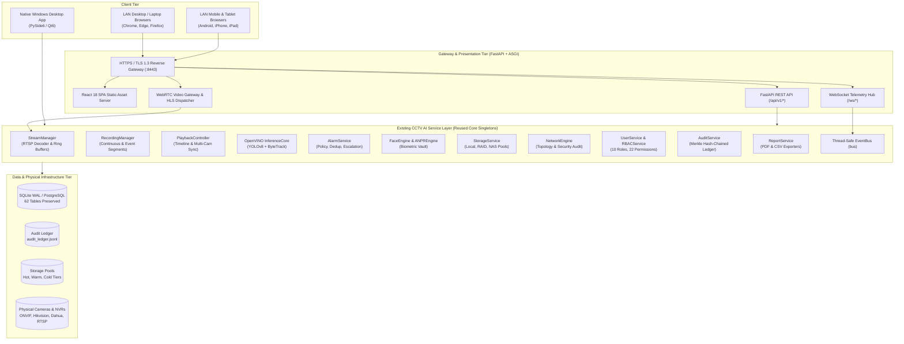
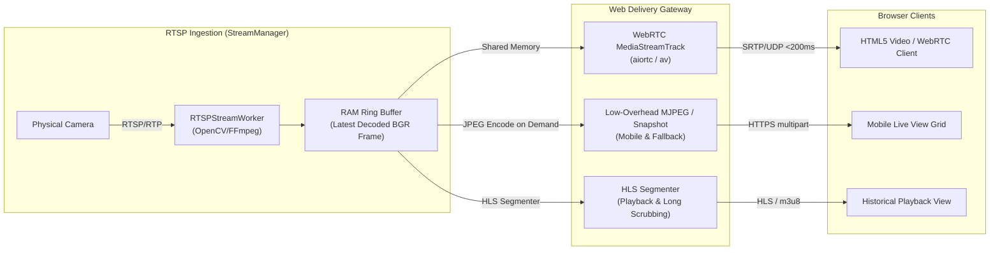
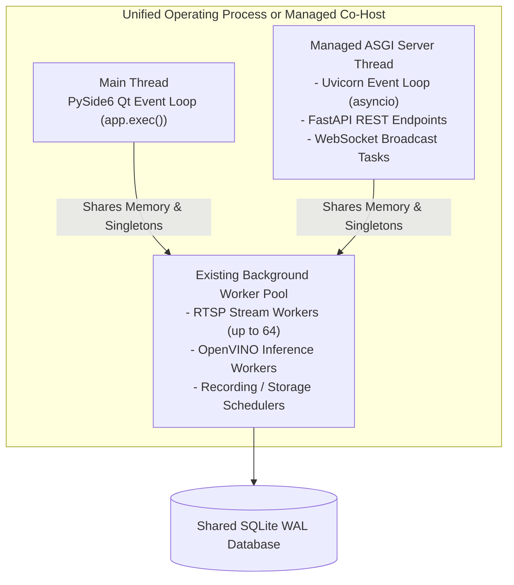

# CCTV AI Intelligence Platform — Web & LAN Architecture Specification

**Document Version:** 1.0.0  
**Baseline Platform Version:** `1.4.0-alpha` (Commit: `4650013c9574bfc4f91362fe63651420a811886c`)  
**Target Release:** `1.5.0-alpha` (Unified Desktop + LAN Web Platform)  
**Author:** Principal Software Architect & Full-Stack Systems Engineer  
**Classification:** Enterprise System Architecture  

---

## 1. Architectural Philosophy & Dual-Interface Model

The CCTV AI Intelligence Platform transforms into a **unified surveillance system** accessible via two first-class interfaces running simultaneously against a single, authoritative surveillance core:

1. **Native Windows Desktop GUI (PySide6):** Low-overhead, high-performance monitoring console installed directly on the primary surveillance server or security operations workstation.
2. **Secure LAN Web Platform (React 18 + TypeScript + FastAPI):** Responsive, browser-accessible interface accessible across Windows PCs, macOS, Linux, iPad/tablets, Android phones, and iPhones connected to the authorized Local Area Network (LAN).

### Architectural Guarantees:
- **Zero Engine Duplication:** Neither FastAPI nor WebRTC introduces a second RTSP connection or second video decoder. All video frames consumed by web clients are tapped from the single, pre-existing `StreamManager` worker thread already ingesting that camera.
- **Single Source of Truth:** All configuration, device records, user accounts, sessions, alarms, and forensic data reside in the single SQLite WAL / PostgreSQL database.
- **Concurrent Operation:** The PySide6 desktop application and FastAPI LAN server can run simultaneously on the Windows host without resource deadlocks or port collisions.
- **Preservation of Completed Work:** All 62 database tables, biometric vaults, AES-256 storage pools, hash-chained audit ledgers, and forensic signing engines remain 100% intact.

---

## 2. Component Architecture Breakdown

### 2.1 Backend Application Layer (FastAPI + Python 3.14)
The backend web server is implemented as a modular FastAPI package located at `web/api/`:
- **FastAPI Application (`web/api/app.py`):** Configured with lifespan management, CORS allowlists restricted to LAN origins, custom middleware for security headers, rate limiting, and request ID correlation.
- **API Routers (`web/api/v1/`):** 20 discrete versioned routers mapped directly to existing services:
  - `auth.py`: Login, logout, session refresh, active sessions.
  - `users.py` & `roles.py`: User lifecycle, role matrix, permission audits.
  - `dashboard.py`: System health, storage utilization, active camera matrix.
  - `devices.py` & `cameras.py`: ONVIF discovery, RTSP validation, profile management.
  - `live.py` & `webrtc.py`: Stream negotiation, WebRTC SDP offer/answer exchange, snapshot extraction.
  - `playback.py` & `recordings.py`: Timeline indexing, clip scrubbing, synchronized playback.
  - `ptz.py`: Continuous pan/tilt/zoom, preset invocation.
  - `analytics.py`: AI rules, tripwires, detection zones, telemetry.
  - `alarms.py` & `incidents.py`: Active alert queues, triage, acknowledgment, escalation.
  - `forensics.py` & `evidence.py`: Hash verification, tamper analysis, evidence locker.
  - `storage.py`: Volume pools, NAS mounts, retention quotas, failover logs.
  - `network.py`: Topology maps, subnet diagnostics, security vulnerability reports.
  - `reports.py`: PDF dossier download, sanitized CSV export.
  - `settings.py` & `system.py`: Application parameters, TLS certificate management, firewall status.
- **WebSocket Gateway (`web/api/websocket/hub.py`):** Subscribes to the central platform `EventBus` (`bus`) and multiplexes real-time telemetry, alarm broadcasts, AI bounding box metadata, and camera status changes to authenticated browser clients.

### 2.2 Video Streaming & Gateway Architecture
Browsers cannot play raw RTSP (H.264/H.265 over RTP/RTSP TCP/UDP) natively. The platform implements a high-performance, zero-duplicate-decoder streaming gateway:

#### Low-Latency Live Video (WebRTC):
- **Protocol:** Interactive WebRTC with VP8 / H.264 video payload.
- **Signaling:** Client POSTs SDP offer to `/api/v1/live/webrtc/offer`; server returns SDP answer.
- **Latency:** Sub-250 milliseconds glass-to-glass latency over LAN Wi-Fi/Ethernet.
- **Resource Protection:** When a web client disconnects, its WebRTC peer connection and frame callback are immediately torn down, ensuring zero decoder or memory leaks.

#### Mobile & High-Grid Fallback (Shared JPEG Pipeline):
- When rendering dense 16, 25, 36, or 64 camera grids on tablets or lower-power mobile devices, clients can request dynamic multi-view frame streams with throttled frame rates (5-10 FPS) and scaled resolutions (360p/720p), preventing client GPU crashes.

### 2.3 Frontend Application Layer (React 18 + TypeScript + Vite)
Located at `web/frontend/`:
- **Modern Build Tooling:** Vite 6 with TypeScript 5, React 18, and Tailwind CSS.
- **Component Architecture:**
  - `AppLayout`: Collapsible dark-themed sidebar, top command bar with real-time clock, server connection badge, and active alarm counter.
  - `LiveGrid`: Dynamic grid layout renderer (1x1, 2x2, 3x3, 4x4, 5x5, 6x6, 8x8) supporting drag-and-drop camera assignment, digital zoom, full-screen expansion, PTZ overlay controls, and stream quality toggles.
  - `PlaybackTimeline`: Synchronized multi-camera timeline scrubber showing recording presence (green) and AI incident markers (amber/red).
  - `AlarmCenter`: Real-time sliding incident notification panel, sound alerts, and modal triage dialogs.
  - `DeviceManager`: Responsive table with network discovery dialog, camera health meters, and configuration editors.
  - `ForensicViewer`: Video hash comparison widget, integrity status badges, and evidence locker.
  - `AdminWorkspace`: User accounts, RBAC matrix, and cryptographic audit log inspector.
- **Mobile-First Responsive Design:**
  - CSS breakpoints (`sm`, `md`, `lg`, `xl`, `2xl`) dynamically switch from a multi-column desktop operations console to a touch-optimized mobile navigation drawer.
  - Mobile bottom navigation bar for quick one-thumb switching between `Live View`, `Alarms`, `Playback`, and `Devices`.

---

## 3. Co-Existence & Concurrency Model

Running PySide6 desktop GUI and FastAPI LAN server concurrently on the same host requires strict thread separation:

### Key Concurrency Principles:
1. **Thread Separation:** The Qt GUI event loop executes on the primary OS thread. Uvicorn runs in a dedicated background daemon thread with its own `asyncio` event loop.
2. **Non-Blocking Bridge:** FastAPI endpoints never call blocking Qt GUI methods. They interact purely with headless service singletons (`stream_manager`, `db_manager`, `user_service`, etc.) that are already thread-safe.
3. **Database Concurrency:** SQLite in Write-Ahead Logging (`WAL`) mode allows multiple concurrent readers (FastAPI REST endpoints and PySide6 UI) while a single writer performs atomic transactions without lock contention.

---

## 4. Hardware Sizing & Capacity on Intel i5-12400 + UHD 730

| Resource | Dedicated Allocation | Surveillance Workload Budget |
| :--- | :--- | :--- |
| **CPU (12 Threads)** | 4 Cores for Ingest/Decoding, 4 Cores for AI/Analytics, 2 Cores for Storage/DB, 2 Cores for FastAPI + PySide6 UI | < 45% average CPU load across 16 continuous 1080p feeds. |
| **RAM (16 GB)** | ~2.5 GB for RTSP Ring Buffers & App, ~1.5 GB for OpenVINO Models & Caches, ~1.0 GB for FastAPI/WebSockets, ~10 GB Free System Headroom | No risk of OOM page swapping. |
| **GPU (UHD 730)** | Primary OpenVINO YOLOv8n object detection & ByteTrack tracking (FP16 precision) | Offloads 70%+ of inference computation from CPU cores. |
| **LAN Bandwidth** | ~2 Mbps per 1080p WebRTC client stream; ~500 Kbps per mobile substream | LAN Gigabit Ethernet / Wi-Fi 6 handles up to 30 concurrent web streams seamlessly. |
