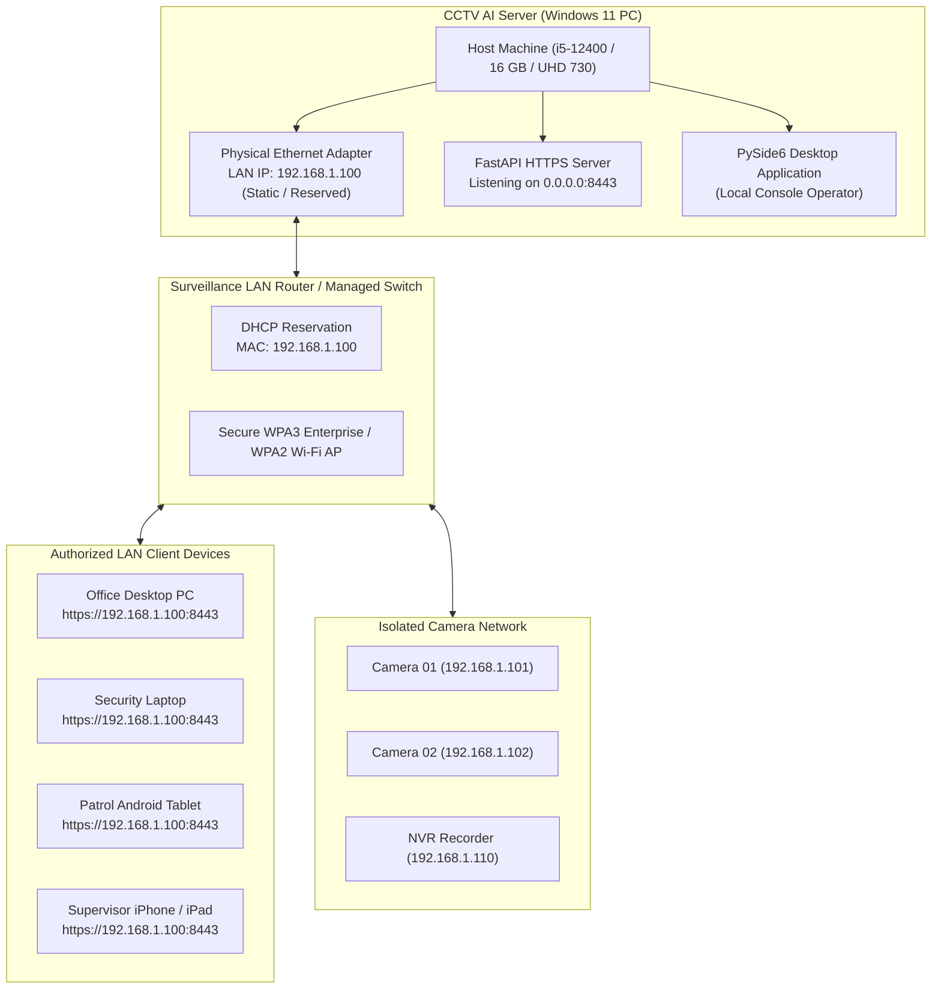

# CCTV AI Intelligence Platform — LAN Deployment & Operational Runbook

**Document Version:** 1.0.0  
**Baseline Version:** `1.4.0-alpha` (Commit: `4650013c9574bfc4f91362fe63651420a811886c`)  
**Target Release:** `1.5.0-alpha`  
**Classification:** Enterprise Deployment & Network Runbook  

---

## 1. Network Topology & Deployment Architecture

The CCTV AI Intelligence Platform runs as an authoritative surveillance server on a Windows 11 host. It provides native PySide6 desktop monitoring on the console while simultaneously serving authorized LAN browser clients over encrypted HTTPS:



---

## 2. Server LAN IP Reservation & Port Configuration

### 2.1 Router DHCP Reservation (Strongly Recommended)
To prevent IP address changes upon server reboot, assign a permanent DHCP reservation in your router:
1. Log into your router admin panel (`http://192.168.1.1`).
2. Navigate to **LAN Setup** / **DHCP Server** / **Address Reservation**.
3. Locate the Windows 11 host's physical MAC address (found by running `getmac` in PowerShell).
4. Assign a fixed IP: `192.168.1.100` (or chosen surveillance server IP).
5. Apply settings and restart the network adapter.

### 2.2 Static IP Configuration via Windows PowerShell
Alternatively, configure a static IP directly in Windows:
```powershell
# Identify the Ethernet interface alias
Get-NetAdapter | Select-Object Name, InterfaceDescription, Status

# Assign static IP, subnet mask, and default gateway
New-NetIPAddress -InterfaceAlias "Ethernet" `
    -IPAddress 192.168.1.100 `
    -PrefixLength 24 `
    -DefaultGateway 192.168.1.1

# Configure DNS server
Set-DnsClientServerAddress -InterfaceAlias "Ethernet" -ServerAddresses ("192.168.1.1", "1.1.1.1")
```

### 2.3 Port Configuration
- **HTTPS Web & API Port:** `8443` (Default).
- Configurable in `config/settings.yaml`:
  ```yaml
  web:
    enabled: true
    host: "0.0.0.0"
    port: 8443
    ssl_cert: "storage/vault/cctv_server.crt"
    ssl_key: "storage/vault/cctv_server.key"
    allowed_subnets:
      - "192.168.1.0/24"
      - "127.0.0.1/32"
  ```

---

## 3. Automated HTTPS Certificate Generation

To enable encrypted communication and browser camera/WebRTC APIs, generate a local Certificate Authority (CA) and Server Certificate:

```powershell
# Execute automated PowerShell setup script
.\scripts\setup_lan_https.ps1 -ServerIP "192.168.1.100" -DnsName "cctv-server.local"
```

The script outputs:
1. `storage/vault/cctv_root_ca.crt`: Root CA certificate (to distribute to client devices).
2. `storage/vault/cctv_server.crt`: Server certificate bound to IP `192.168.1.100`.
3. `storage/vault/cctv_server.key`: Private key protected with Windows DPAPI permissions.

---

## 4. Client Certificate Trust Installation Guide

### 4.1 Windows 10 & 11 PCs (Edge, Chrome, Firefox)
1. Copy `cctv_root_ca.crt` to the client Windows PC.
2. Double-click `cctv_root_ca.crt` and click **Install Certificate...**
3. Select **Local Machine** and click **Next**.
4. Choose **Place all certificates in the following store** -> Click **Browse...**
5. Select **Trusted Root Certification Authorities** -> Click **OK** -> Click **Next** -> Click **Finish**.
6. Restart Chrome or Edge. Navigate to `https://192.168.1.100:8443`. The green padlock displays immediately.

### 4.2 Android Phones & Tablets (Chrome / Samsung Internet)
1. Transfer `cctv_root_ca.crt` to the phone via USB cable, Google Drive, or local email.
2. Open phone **Settings** -> **Security & Privacy** -> **More Security Settings**.
3. Tap **Encryption & credentials** -> **Install a certificate** -> **CA certificate**.
4. Tap **Install anyway** and select `cctv_root_ca.crt`.
5. Enter a name (e.g. `CCTV AI Root CA`) and confirm with your device PIN.
6. Open Chrome on Android and navigate to `https://192.168.1.100:8443`.

### 4.3 Apple iPhone & iPad (Safari)
1. AirDrop or download `cctv_root_ca.crt` to the iOS device.
2. Tap **Allow** when prompted: *"This website is trying to download a configuration profile."*
3. Open **Settings** -> Tap **Profile Downloaded** at the top -> Tap **Install** -> Enter passcode -> Tap **Install**.
4. Enable Full Trust: Open **Settings** -> **General** -> **About** -> **Certificate Trust Settings**.
5. Under *"Enable full trust for root certificates"*, toggle the switch **ON** for `CCTV AI Root CA`.
6. Open Safari on iOS and navigate to `https://192.168.1.100:8443`.

---

## 5. Windows Firewall Rule Automation

Run the provided PowerShell script as Administrator to restrict inbound HTTPS traffic exclusively to the local subnet:

```powershell
.\scripts\configure_windows_firewall.ps1 -Port 8443 -Subnet "192.168.1.0/24"
```

The script:
- Removes any conflicting or permissive rules on port 8443.
- Creates rule `CCTV-AI-LAN-HTTPS-8443` allowing inbound TCP `8443` strictly from `192.168.1.0/24`.
- Enforces the `Private` network profile, ensuring the port automatically shuts down if the machine connects to an untrusted public network.

---

## 6. Service Management & Runbooks

### 6.1 Starting the Unified Platform (Desktop + LAN Web)
```powershell
# Start unified desktop application with background LAN web service
python app/main.py --enable-lan-web
```
Or start headless LAN server as a dedicated Windows background service:
```powershell
python -m web.server --host 0.0.0.0 --port 8443
```

### 6.2 Health Verification Endpoint
From any authorized LAN device, verify service connectivity:
```bash
curl -k https://192.168.1.100:8443/api/v1/system/health
```
Expected response:
```json
{
  "status": "HEALTHY",
  "version": "1.5.0-alpha",
  "desktop_gui_active": true,
  "database": "CONNECTED",
  "active_streams": 16,
  "openvino_device": "GPU (Intel UHD Graphics 730)",
  "storage_pool_status": "NORMAL"
}
```
