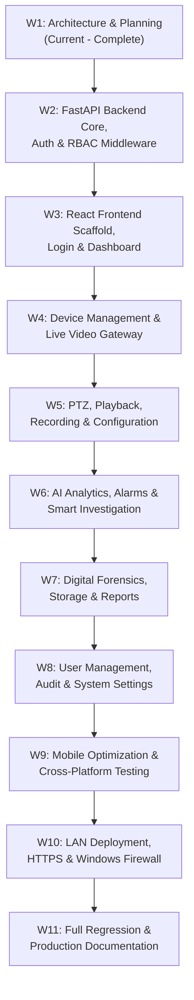

# CCTV AI Intelligence Platform — Complete Web Implementation Plan (W1 – W11)

**Document Version:** 1.0.0  
**Baseline Version:** `1.4.0-alpha` (Commit: `4650013c9574bfc4f91362fe63651420a811886c`)  
**Target Release:** `1.5.0-alpha`  
**Classification:** Master Implementation Plan & Work Breakdown Structure  

---

## 1. Executive Strategy

The web platform is implemented in **11 sequential, strictly verified milestones (W1 through W11)**. Each milestone has an explicit scope, affected file list, zero database destruction guarantee, automated test verification criteria, and a mandatory review gate before subsequent milestones proceed.

---

## 2. Milestone Breakdown & Technical Scope

### Milestone W1: Codebase Audit & Architectural Blueprints (Current Milestone)
- **Scope:** Complete repository inspection; service reuse mapping; authoring the 5 master architectural blueprints (`WEB_ARCHITECTURE.md`, `WEB_IMPLEMENTATION_PLAN.md`, `WEB_API_SPECIFICATION.md`, `WEB_SECURITY_DESIGN.md`, `WEB_DEPLOYMENT_DESIGN.md`).
- **Files Created:**
  - `docs/WEB_ARCHITECTURE.md`
  - `docs/WEB_IMPLEMENTATION_PLAN.md`
  - `docs/WEB_API_SPECIFICATION.md`
  - `docs/WEB_SECURITY_DESIGN.md`
  - `docs/WEB_DEPLOYMENT_DESIGN.md`
- **Database Changes:** None. All 62 existing tables preserved.
- **Verification Gate:** Architectural review and user authorization before writing code in W2.

---

### Milestone W2: FastAPI Backend Core, Authentication & RBAC Middleware
- **Scope:**
  - Scaffold `web/api/` package with FastAPI application and Uvicorn server launcher.
  - Implement authentication router (`/api/v1/auth/login`, `logout`, `refresh`, `me`, `sessions`).
  - Implement session cookie middleware, CSRF token validation, security headers middleware, and request correlation ID injection.
  - Implement FastAPI dependency `get_current_user` and `require_permission(code)` bridging directly into existing `core.security.user_service` and `core.security.rbac`.
  - Add WebSocket hub (`/ws/events`) subscribing to `core.events.event_bus.bus`.
- **Files to Create/Modify:**
  - `web/__init__.py`, `web/server.py`
  - `web/api/__init__.py`, `web/api/app.py`
  - `web/api/deps.py` (FastAPI authentication & RBAC dependencies)
  - `web/api/middleware/security.py`, `web/api/middleware/correlation.py`
  - `web/api/v1/auth.py`
  - `web/api/websocket/hub.py`
  - `web/schemas/auth.py`, `web/schemas/common.py`
  - `tests/unit/test_web_auth_api.py`
- **Database Changes:** None. Uses existing `users`, `roles`, `permissions`, and `user_sessions` tables.
- **Verification Gate:** Automated unit/integration tests verifying login, lockout enforcement, session expiration, RBAC rejection, and WebSocket connection.

---

### Milestone W3: React 18 Frontend Scaffold, Authentication & Responsive Dashboard
- **Scope:**
  - Scaffold `web/frontend/` using Vite 6 + React 18 + TypeScript + Tailwind CSS.
  - Setup Lucide React icons, Tailwind surveillance dark theme matching PySide6 desktop.
  - Implement responsive application shell: collapsible desktop sidebar, mobile drawer, top status bar with live server connection indicator and active alarm badge.
  - Build Login view with error handling and session storage.
  - Build Dashboard view: camera count, online status, storage usage meters, active alarm list, CPU/RAM telemetry, and quick-action shortcuts.
- **Files to Create:**
  - `web/frontend/package.json`, `web/frontend/vite.config.ts`, `web/frontend/tailwind.config.js`
  - `web/frontend/src/App.tsx`, `web/frontend/src/main.tsx`
  - `web/frontend/src/context/AuthContext.tsx`, `web/frontend/src/context/WebSocketContext.tsx`
  - `web/frontend/src/components/layout/AppLayout.tsx`, `Sidebar.tsx`, `Header.tsx`, `MobileNav.tsx`
  - `web/frontend/src/pages/Login.tsx`, `web/frontend/src/pages/Dashboard.tsx`
  - `web/frontend/src/services/apiClient.ts`
- **Verification Gate:** Frontend builds cleanly (`npm run build`); browser login, dashboard rendering, and WebSocket telemetry reception verified.

---

### Milestone W4: Device Management & Browser Video Delivery Gateway (WebRTC / MJPEG)
- **Scope:**
  - Backend `/api/v1/devices/` and `/api/v1/cameras/` endpoints reusing `stream_manager` and database device queries.
  - Video streaming gateway (`web/api/streaming/`):
    - WebRTC signaling (`/api/v1/live/webrtc/offer`) connecting browser WebRTC clients to existing decoded frames without duplicate RTSP decoders.
    - Low-overhead MJPEG snapshot stream fallback (`/api/v1/live/{channel_id}/stream.mjpg`) for mobile / high grid density.
  - Frontend Live Monitoring view:
    - Flexible grid selector: 1, 4, 9, 16, 25, 36, 64-camera layouts.
    - Video tile component: full-screen toggle, snapshot capture, digital zoom, stream quality selector (Main/Sub), connection status badge, and recording indicator.
  - Frontend Device Management view: camera inventory table, ONVIF discovery trigger, manual camera addition modal.
- **Files to Create/Modify:**
  - `web/api/v1/devices.py`, `web/api/v1/cameras.py`, `web/api/v1/live.py`
  - `web/api/streaming/webrtc_gateway.py`, `web/api/streaming/mjpeg_streamer.py`
  - `web/frontend/src/pages/LiveMonitoring.tsx`, `web/frontend/src/pages/DeviceManagement.tsx`
  - `web/frontend/src/components/video/VideoTile.tsx`, `web/frontend/src/components/video/WebRTCPlayer.tsx`, `GridLayout.tsx`
  - `tests/integration/test_web_streaming_gateway.py`
- **Verification Gate:** Video streams render in browser over WebRTC and MJPEG without memory leaks; RTSP session count remains strictly 1 per camera.

---

### Milestone W5: Universal PTZ, Playback, Recording Schedules & Safe Configuration
- **Scope:**
  - Backend endpoints: `/api/v1/ptz/` (pan, tilt, zoom, presets), `/api/v1/playback/` (timeline search, scrubbing, clip extraction), `/api/v1/recordings/` (schedules, retention status).
  - 12-step safe camera configuration engine with diff, explicit operator confirmation, and rollback preview.
  - Frontend Playback view: multi-camera timeline scrubber, date-time picker, pause/play, playback speed control (1x, 2x, 4x, 8x), and MP4 evidence clip download.
  - Frontend PTZ virtual joystick, zoom sliders, and preset recall buttons.
- **Files to Create/Modify:**
  - `web/api/v1/ptz.py`, `web/api/v1/playback.py`, `web/api/v1/recordings.py`, `web/api/v1/config_manager.py`
  - `web/frontend/src/pages/Playback.tsx`, `web/frontend/src/pages/CameraConfig.tsx`
  - `web/frontend/src/components/playback/TimelineScrubber.tsx`, `PTZControls.tsx`
  - `tests/unit/test_web_playback_api.py`
- **Verification Gate:** Playback timeline matches physical recording files on disk; PTZ commands dispatch correctly; safe configuration enforces confirmation before applying.

---

### Milestone W6: AI Analytics, Alarm Management & Smart Investigation
- **Scope:**
  - Backend endpoints: `/api/v1/analytics/` (rule evaluator, detection zones), `/api/v1/alarms/` (queue, triage, acknowledge, resolve, escalate), `/api/v1/investigation/` (metadata search: object class, clothing color, vehicle plate).
  - Frontend Real-Time Alarm Workspace: sliding active alarm drawer, audio notifications, alarm detail modal with camera snapshots, event history timeline, and operator note taking.
  - Frontend AI Analytics & Investigation: live bounding box overlays on web video tiles, rule configuration canvas, and natural metadata search filters.
- **Files to Create/Modify:**
  - `web/api/v1/analytics.py`, `web/api/v1/alarms.py`, `web/api/v1/investigation.py`
  - `web/frontend/src/pages/AlarmManagement.tsx`, `web/frontend/src/pages/AIAnalytics.tsx`, `web/frontend/src/pages/Investigation.tsx`
  - `web/frontend/src/components/alarms/AlarmBanner.tsx`, `AlarmTriageModal.tsx`
  - `tests/integration/test_web_alarm_workflow.py`
- **Verification Gate:** Alarms triggered in backend appear instantly on web clients via WebSockets; alarm acknowledgment and resolution reflect immediately on desktop and web simultaneously.

---

### Milestone W7: Digital Forensics, Storage Pools & Intelligence Reports
- **Scope:**
  - Backend endpoints: `/api/v1/forensics/` (frame integrity, discontinuity, SHA-256 / ECDSA check), `/api/v1/evidence/` (evidence locker, packaging), `/api/v1/storage/` (volume pools, NAS mounts, retention quotas), `/api/v1/reports/` (PDF and CSV exports).
  - Frontend Digital Forensics view: cryptographic verification badge, evidence locker search, court-admissible package download.
  - Frontend Storage view: volume capacity gauges, disk health status, failover event log.
  - Frontend Reports view: PDF report generator preview, CSV download with CWE-1236 protection.
- **Files to Create/Modify:**
  - `web/api/v1/forensics.py`, `web/api/v1/evidence.py`, `web/api/v1/storage.py`, `web/api/v1/reports.py`
  - `web/frontend/src/pages/DigitalForensics.tsx`, `web/frontend/src/pages/StorageManagement.tsx`, `web/frontend/src/pages/Reports.tsx`
  - `tests/unit/test_web_reports_api.py`
- **Verification Gate:** Cryptographic evidence verification matches desktop results; PDF/CSV reports download cleanly in browser.

---

### Milestone W8: User Administration, Audit Ledger & System Settings
- **Scope:**
  - Backend endpoints: `/api/v1/users/` (CRUD, unlock, reset password), `/api/v1/roles/` (role matrix, permissions), `/api/v1/audit/` (query ledger, cryptographic chain verification), `/api/v1/settings/` (system config, TLS certificates, network parameters).
  - Frontend User Management view: user table, role assignment dialog, failed login status pill, unlock button.
  - Frontend Audit Ledger view: sequential log table, Merkle hash verification button, filtering by category and date.
  - Frontend System Settings view: LAN IP configuration, TLS certificate status, storage directories, logging levels.
- **Files to Create/Modify:**
  - `web/api/v1/users.py`, `web/api/v1/roles.py`, `web/api/v1/audit.py`, `web/api/v1/settings.py`, `web/api/v1/system.py`
  - `web/frontend/src/pages/UserManagement.tsx`, `web/frontend/src/pages/AuditViewer.tsx`, `web/frontend/src/pages/SystemSettings.tsx`
  - `tests/unit/test_web_admin_api.py`
- **Verification Gate:** Full administrative workflows execute with proper RBAC enforcement; Merkle ledger verification reports 100% integrity.

---

### Milestone W9: Mobile & Tablet Responsiveness Optimization & Cross-Platform QA
- **Scope:**
  - Comprehensive responsiveness pass across viewport sizes:
    - Mobile (360px – 480px, Android & iPhone).
    - Tablet (768px – 1024px, iPad & Android Tablets).
    - Desktop / Laptop (1280px – 2560px).
  - Touch gestures: pinch-to-zoom on video tiles, swipe-to-dismiss for alarms.
  - Mobile bottom navigation bar and condensed alarm cards.
  - Video stream bandwidth adaptation (auto-downgrade to substream on mobile viewports to prevent memory pressure).
- **Files to Create/Modify:**
  - `web/frontend/src/components/mobile/MobileLiveGrid.tsx`, `MobileAlarmList.tsx`
  - `tests/integration/test_web_mobile_responsiveness.py`
- **Verification Gate:** Mobile viewport tests pass without layout breakage; touch controls respond fluidly.

---

### Milestone W10: LAN Deployment, HTTPS & Windows Firewall Setup
- **Scope:**
  - Automated PowerShell script `scripts/setup_lan_https.ps1` generating local self-signed or internal CA certificate (`cctv_server.crt`, `cctv_server.key`).
  - Automated PowerShell script `scripts/configure_windows_firewall.ps1` creating inbound firewall rules for port 8443 restricted to authorized LAN subnets (`192.168.1.0/24`, etc.).
  - Uvicorn SSL configuration running HTTPS on port 8443.
  - Certificate trust instructions for Windows, Android, and iOS client devices.
  - Unified server launcher `scripts/start_lan_server.py` and Windows Service configuration.
- **Files to Create:**
  - `scripts/setup_lan_https.ps1`, `scripts/configure_windows_firewall.ps1`
  - `scripts/start_lan_server.py`, `web/server.py`
  - `docs/LAN_CERTIFICATE_SETUP_GUIDE.md`
- **Verification Gate:** Server binds to LAN IP on port 8443; HTTPS functions; unauthorized external subnets blocked by Windows Firewall.

---

### Milestone W11: Full Platform Regression & Production Documentation
- **Scope:**
  - Full automated regression test suite run (preserving baseline 484 tests + all new web tests).
  - Simultaneous desktop + web concurrency stress test (verifying zero thread deadlocks or performance degradation).
  - Authoring comprehensive production documentation:
    - `docs/WEB_USER_MANUAL.md`
    - `docs/LAN_ADMINISTRATOR_GUIDE.md`
    - `docs/API_DOCUMENTATION.md`
    - `docs/PHASE_15_WEB_COMPLETION_REPORT.md`
  - Updating `VERSION` to `1.5.0-alpha`, `docs/CHANGELOG.md`, `docs/FEATURE_REGISTER.md`, and `docs/DEVELOPMENT_STATUS.md`.
- **Verification Gate:** 100% test pass rate across desktop and web test suites; clean working tree; complete documentation.
