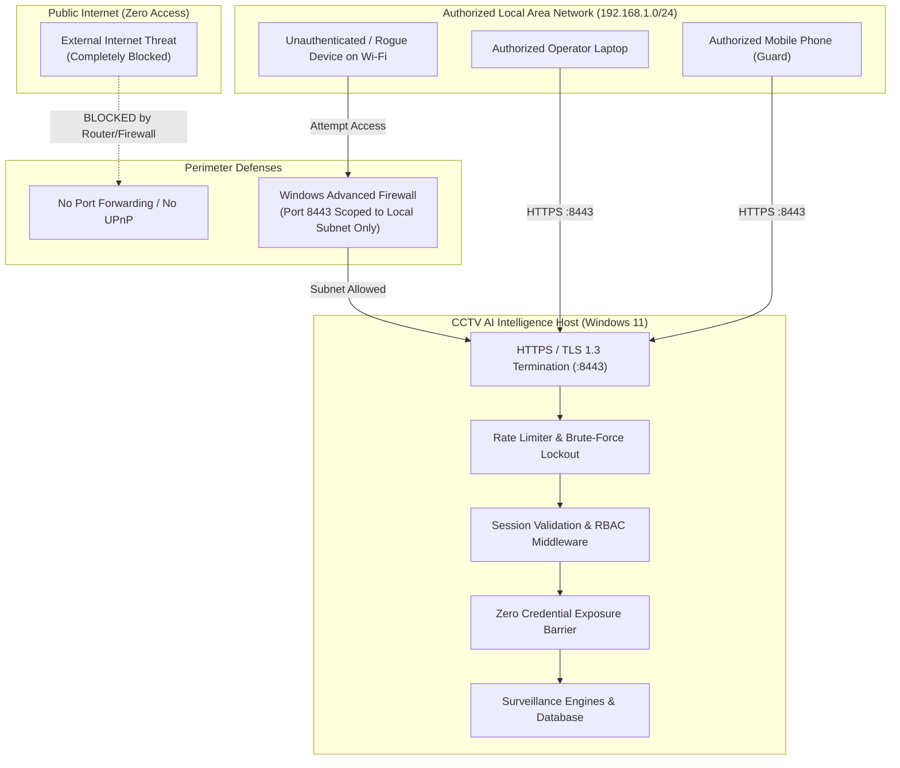

# CCTV AI Intelligence Platform — Web & LAN Security Design

**Document Version:** 1.0.0  
**Baseline Version:** `1.4.0-alpha` (Commit: `4650013c9574bfc4f91362fe63651420a811886c`)  
**Target Release:** `1.5.0-alpha`  
**Classification:** Enterprise Security Architecture & Threat Model  

---

## 1. Threat Model & Security Perimeter

The CCTV AI Intelligence Platform processes sensitive physical security telemetry, continuous video recordings, biometric watchlists, and judicial evidence. Deploying browser access across a Local Area Network (LAN) introduces specific risks that must be defended against:



### Threat Vectors & Mitigations:
| Threat | Mitigation Architecture |
| :--- | :--- |
| **Unauthorized Internet Access** | Zero router port forwarding. Application explicitly binds only to the local physical network adapter. Windows Firewall restricts port 8443 to the local CIDR subnet. |
| **Eavesdropping on LAN Wi-Fi** | Mandatory TLS 1.3 encryption (HTTPS & WSS). All credentials, video frames, and telemetry are encrypted in transit over the local network. |
| **Credential Snooping in Browser** | Camera passwords and RTSP URLs are strictly isolated in backend memory and DPAPI vault. Web clients receive only stream tokens and WebRTC SDP tracks. Zero credentials in URLs or responses. |
| **Brute-Force & Credential Stuffing** | 5-attempt account lockout for 15 minutes; IP-level rate limiting on `/api/v1/auth/login` (max 5 requests per minute per IP). |
| **Cross-Site Request Forgery (CSRF)** | `SameSite=Strict` and `HttpOnly` cookie attributes; custom `X-CCTV-CSRF-Token` header required on state-changing requests (`POST`, `PUT`, `DELETE`). |
| **Session Hijacking / Fixation** | Cryptographically random 256-bit entropy session tokens (`secrets.token_urlsafe(32)`); session regenerated upon authentication; 30-minute idle expiration. |
| **Privilege Escalation** | Every single API route validates fine-grained permissions via backend `@require_permission` decorator; non-admins cannot elevate roles or modify audit trails. |
| **CSV Formula Injection (CWE-1236)** | All exported spreadsheet cells sanitized with single-quote prefixing (`'=`, `'+`, `'-`, `'@`). |

---

## 2. HTTPS / TLS 1.3 Implementation

### 2.1 Cipher Suites & Protocols
- **Minimum Protocol:** TLS 1.2 (TLS 1.3 preferred and enforced where supported).
- **Recommended Cipher Suites:**
  - `TLS_AES_256_GCM_SHA384` (TLS 1.3)
  - `TLS_CHACHA20_POLY1305_SHA256` (TLS 1.3)
  - `ECDHE-ECDSA-AES256-GCM-SHA384` (TLS 1.2)
  - `ECDHE-RSA-AES256-GCM-SHA384` (TLS 1.2)
- **HSTS:** Enabled with `max-age=31536000; includeSubDomains`.

### 2.2 Certificate Management Strategy
Because the platform operates in a closed local area network without a public domain name, standard public Let's Encrypt certificates are not feasible without public DNS validation. The platform provides a streamlined two-tier certificate approach:
1. **Self-Signed Enterprise Certificate:** Automated script generates a 4096-bit RSA or 384-bit ECDSA certificate with `Subject Alternative Name` (SAN) matching the host's reserved LAN IP (e.g. `IP:192.168.1.100`, `DNS:cctv-server.local`).
2. **Internal Enterprise CA (Recommended for Multi-Device):** The server generates a root Certificate Authority (`cctv_root_ca.crt`). The root CA certificate is installed once onto client devices (Windows, Android, iOS), ensuring all browsers trust the CCTV server without scary certificate warning screens.

---

## 3. Windows Firewall Integration

To guarantee that the web application cannot be reached from unauthorized networks or multi-homed virtual interfaces (e.g., WSL, Docker, Hyper-V, or external interfaces), an automated configuration script configures the Windows Advanced Firewall:

```powershell
# Scopes port 8443 strictly to the authorized local LAN subnet
New-NetFirewallRule -DisplayName "CCTV AI Intelligence Platform LAN Access (HTTPS)" `
    -Direction Inbound `
    -LocalPort 8443 `
    -Protocol TCP `
    -Action Allow `
    -RemoteAddress 192.168.1.0/24 `
    -Profile Private
```

- **Remote Address Scoping:** Restricts traffic exclusively to the local network CIDR prefix (e.g. `192.168.1.0/24`).
- **Profile Restriction:** Restricts rule strictly to Windows `Private` network profile, blocking access if the machine is accidentally switched to `Public`.

---

## 4. Authentication, Cookies & Session Security

### 4.1 Cookie Security Attributes
The authentication session cookie (`cctv_session`) is configured with maximum browser protection:
```http
Set-Cookie: cctv_session=8f7e6d5c4b3a2019...; Path=/; Secure; HttpOnly; SameSite=Strict; Max-Age=1800
```
- `HttpOnly`: Prevents client-side JavaScript (XSS attacks) from reading the session token.
- `Secure`: Instructs the browser to only transmit the cookie over encrypted HTTPS connections.
- `SameSite=Strict`: Prevents the cookie from being sent on cross-site requests, completely eliminating cross-origin CSRF attacks.
- `Max-Age=1800`: 30-minute idle session lifetime.

### 4.2 Cross-Origin Resource Sharing (CORS) Policy
- `allow_origins`: Explicitly restricted to the server's own LAN IP and port:
  `["https://192.168.1.100:8443", "https://localhost:8443"]`
- `allow_credentials`: `True` (for session cookie).
- `allow_methods`: `["GET", "POST", "PUT", "DELETE", "OPTIONS"]`.
- `allow_headers`: `["Authorization", "Content-Type", "X-CCTV-CSRF-Token", "X-Correlation-ID"]`.
- Wildcard `*` origins are strictly prohibited.

---

## 5. Camera & Secret Isolation

Physical surveillance camera credentials (usernames, passwords, RTSP auth hashes) must never be accessible to web clients:

1. **Zero Exposure in Browser:**
   - Database queries returning device lists for the web client specifically exclude `password`, `rtsp_url_with_auth`, and `auth_token`.
   - The frontend only receives: `device_id`, `name`, `ip_address`, `model`, `status`, `capabilities`.
2. **WebRTC Stream Tokenization:**
   - To view a live video feed, the web client passes `channel_id` to `/api/v1/live/webrtc/offer`.
   - The backend validates the user's `live:view` permission and attaches the WebRTC track directly to the server's internal decoded frame buffer. The browser client never touches or sees the RTSP URL.

---

## 6. Audit Logging of Web Events

Every web API action is tied to the operator's authenticated identity and logged into the tamper-evident rolling Merkle hash chain:
- `AUTH:LOGIN_SUCCESS`: Logged with remote LAN IP address, user agent, session ID.
- `AUTH:LOGIN_FAILED`: Logged with attempted username, IP address, and updated lockout counter.
- `LIVE:STREAM_STARTED`: Logged when an operator initiates a live camera view.
- `CAMERA:PTZ_COMMAND`: Logged when an operator commands PTZ movement.
- `RECORDING:PLAYBACK_ACCESSED`: Logged when historical footage is scrubbed.
- `EVIDENCE:EXPORT_PACKAGE`: Logged with generated evidence ID and operator notes.
- `USER:MANAGE_UPDATE`: Logged with operator ID and modified target user.
